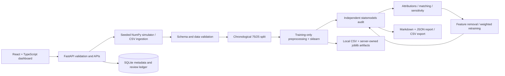

# FairPrice AI

A local research platform for **Algorithmic Micro-Redlining in Dynamic Pricing**. Simulate pricing worlds, train actual estimators, independently audit geographic disparities, investigate predictions, retrain feature policies, and retain human review records.

[Open the public demo](https://fairprice-demo.chatbot-sockscarving.workers.dev/) while the host Mac is online.

## Current local release

The interface has been redesigned with a neutral research layout, persistent source/model context, a live backend health check, new-transaction inference, and a **System checks** page that recomputes saved-run evidence. Dataset/model switching resets dependent results. Artifact writes are atomic; new artifacts have SHA-256 integrity checks. SQLite connections are explicitly closed and concurrent initialization is tested.

- [Feature acceptance checklist](docs/ACCEPTANCE.md)
- [Where the data/model predictions come from](docs/MODEL-AND-DATA.md)
- [Presentation walkthrough](docs/PRESENTATION.md)
- [Deployment notes](docs/DEPLOYMENT-NOTES.md)

Run `./scripts/verify.sh` for the complete local automated check.

## Run locally

After completing the environment setup below, launch from the project root:

```bash
./run.sh
```

Open **http://127.0.0.1:8000**. API documentation: **http://127.0.0.1:8000/docs**. Stop with Ctrl+C. If port 8000 is occupied by an existing FairPrice process, use that running instance or stop it first. To use another port: `PORT=8001 ./run.sh`.

### Recreate the environment

Use Python **3.12** and Node **22** (tested on macOS ARM64). The host's default Python 3.15 was deliberately not used: a bundled Python 3.12 supplied compatible scientific-library wheels.

```bash
python3.12 -m venv .venv
.venv/bin/python -m pip install -r requirements.lock.txt
npm ci --prefix frontend
npm run build --prefix frontend
./run.sh
```

`requirements.txt` lists direct application dependencies; `requirements.lock.txt` pins the installed environment, including PDF inspection tools. `frontend/package-lock.json` pins Node dependencies.

For frontend development, keep the backend running and execute `npm run dev --prefix frontend`; Vite proxies `/api` to port 8000. Production serves the built frontend directly from FastAPI. No Docker, cloud credentials, paid services, or runtime network access are needed.

## Architecture and technology choices



Python provides inspectable scientific implementations. FastAPI supplies typed validation and OpenAPI. SQLite avoids infrastructure and persists experiments across restarts. React, TypeScript, Recharts, and Lucide provide an interactive dashboard with local bundled assets. Models are never run in the frontend.

- `backend/core.py`: simulation, validation, estimators, inference, matching and explanations.
- `backend/app.py`: dataset, model, audit, sensitivity, mitigation, review and export APIs.
- `backend/store.py`: parameterized SQLite records and atomically written server-owned artifacts.
- `backend/inspection.py`: new-trip inference, model/data lineage and saved-run verification.
- `frontend/src/`: dashboard with ten integrated research sections.
- `tests/`: numerical research and API workflow checks.
- `scripts/experiments.py`: multi-seed reproducibility suite.
- `docs/experiment-results.json`: actual output from the executed suite.
- `data/`: local runtime data (ignored by Git). Override with `FAIRPRICE_DATA=/absolute/path`.

## Data-generating process

Prices are in arbitrary **currency units (CU)**. Transactions are independent draws over a synthetic 60-day period beginning January 2026. Timestamp hours match time-of-day features. Three zones have probabilities 0.40, 0.35, 0.25. Zone is a synthetic service area, not a real location or demographic category.

Let `T` indicate the selected target zone (default B):

- Distance `d ~ Gamma(shape=3, scale=2) + 0.6T` km.
- Duration `t = 2d + Uniform(2,9)` minutes.
- Demand `q ~ Uniform(0.2,2) + 0.15T`.
- Supply/availability `a ~ Uniform(0.2,1)`.
- Verified operating cost `c = 1 + 0.22d + Uniform(0,2)`.
- Hour `h` is uniform over 0–23; use sine/cosine cyclic encoding.
- Pickup density `x = clip(Normal(0.25+0.5T, 0.13), 0, 1)`.
- Legitimate price `p_fair = 4 + 1.2d + 0.18t + 2q - 2a + 1.3c + 0.7sin(2πh/24) + 0.3cos(2πh/24)`.
- Noise `ε ~ Normal(0, noise²)`; **A:** `p=p_fair+ε`; **B:** `p=p_fair+bias*T+ε`; **C:** `p=p_fair+bias*x+ε`.

Bias in B is an additive premium, not a percentage. In C, the target/reference density difference is about 0.5, so a bias coefficient of 4 produces a geographic gap near 2. Density is deliberately *not* considered a justified operational control; controlling it away would obscure the mechanism being studied. In C, geography is forcibly excluded from every pricing model, even if an unrestricted configuration is requested. The effective features are recorded.

`audit_group` is audit-only and is never selected by the feature allowlist. No real sensitive information is generated. `ground_truth_fair_price` and `planted_premium` are separate validation fields and are never passed to models or the independent audit. The audit estimates disparities from outcomes and operational covariates.

Gaussian noise is not truncated to preserve the specified conditional mean. At extreme noise settings, negative synthetic prices can occur; those are model stress cases, not realistic production charges. The simulator is intentionally simpler than real platform data.

## Ingestion and validation

CSV import accepts 300–15,000 rows with `transaction_id`, `timestamp`, `geographic_zone` (Zone A/B/C), `time_of_day` (0–23), `distance_km`, `duration_min`, `demand_level`, `availability`, `operating_cost`, `pickup_density`, and `observed_price`. Cyclic hour features are recomputed. Optional extra columns are retained for inspection but never automatically admitted into models. The UI's CSV export supplies a ready-to-import example.

IDs must be unique; timestamps parseable; observed outcomes finite; geographic labels recognized. Missing numerical predictors are imputed with **training-only medians**. Entirely missing features and infinities are rejected. Audits use complete operational rows and report exclusion counts. Imputation is a pragmatic baseline, not a solution to nonrandom missingness. Imported data require provenance review and appropriate justification for controls.

## Pricing and evaluation

Linear regression is the interpretable baseline. Random forest uses 80 trees, maximum depth 14, minimum leaf size 8, two worker threads and a recorded seed. Numeric preprocessing uses median imputation. Geographic features, when permitted, use one-hot encoding with the first category dropped. Model comparison uses a deterministic chronological first-75%/last-25% split.

MAE = mean absolute observed-minus-predicted error. RMSE = square root of mean squared error. The dashboard shows every held-out prediction, an error histogram, per-zone errors and four temporal slices. It records train/test dates, ID overlap, feature lists and unseen test zones. Preprocessing is fit only on the training portion. Sharing known zones across dates is intentional; this evaluates future transactions in known geography, **not** transfer to unseen zones. Avoid choosing models repeatedly on the test set for confirmatory inference; add a validation split for a formal tuning study.

## Fairness methodology

**Raw gap:** mean outcome in Zone B or C minus the mean in Zone A. Different operational mixes can explain this difference.

**Adjusted gap:** independently fit `outcome = intercept + βᵀX_operational + γ_B I(B) + γ_C I(C) + ε` on held-out rows. The zone coefficients estimate remaining conditional associations. The audit does not read planted bias, ground truth, pricing-model coefficients, or the proxy. It is run separately on observed prices, predicted prices, and residuals.

Inference uses HC3 heteroskedasticity-robust covariance, two-sided tests and 95% pointwise intervals. Holm correction covers the two zone contrasts **within each outcome**, not every outcome, seed, model, or exploratory interaction. At least 50 complete rows and 15 in each zone are required. Intervals condition on a fitted predictor and do not include training uncertainty. Independent observations, adequate overlap and correctly specified conditional means remain important assumptions. Near-zero predicted gaps from an operational-only linear model are a consequence of using the same operational basis in the audit; they are not proof of real-world fairness.

**Operational component:** raw gap minus adjusted coefficient. This is a statistical decomposition, not causal attribution of a price premium.

**Residual analysis:** `r = observed - predicted`. Positive residual means underprediction. A model can fit biased prices very accurately and have balanced residuals while retaining a large charged-price disparity.

**Matching:** Zone B transactions are greedily paired to Zone A without replacement, nearest candidates first. Every operational coordinate must differ by at most 1.25 held-out standard deviations (Chebyshev caliper). Results include coverage, unique pair IDs, covariates, price differences and an exploratory paired t interval. Low-coverage warnings appear below 50%. Matching is imperfect; intervals ignore selection uncertainty and may retain residual confounding. Up to 100 pairs are displayed and the first 10 include detailed conditions; aggregates use all accepted pairs. Matching is fixed to B versus A even when the simulator's target changes; the regression audit still includes both B/A and C/A contrasts.

**Sensitivity:** modify geography, density, distance or demand while holding other inputs fixed and run the saved estimator again. Global diagnostics compare B versus A and density 0.8 versus 0.2 across held-out rows. These may create unsupported input combinations; they are model-sensitivity experiments, not causal counterfactuals.

## Explainability

Linear coefficients retain native input units. The exact additive individual explanation is `(x_j - training_mean_j) * coefficient_j`, plus a training-background prediction. This follows the interventional linear SHAP convention, not conditional SHAP under correlation.

The forest uses an explicitly labeled **Monte Carlo interventional Shapley approximation**, with 64 deterministic random feature orders and 16 training-background rows. It operates on encoded features and sums to the actual prediction. This avoids an additional SHAP package while exposing the method and approximation. It is not TreeSHAP; sampled attributions have Monte Carlo variability and can evaluate off-support feature combinations. Held-out permutation importance reports mean and SD across three shuffles; correlated variables can dilute rankings. None of these methods proves social causation.

## Mitigation laboratory

Remove explicit geography, remove density, keep only operational features, or equalize zone representation with training weights `N/(3*N_zone)`. Each action retrains the estimator, retains a parent experiment ID and re-evaluates **identical test transactions**. The before/after view shows utility, adjusted predicted gaps, original observed gaps, group residuals and sensitivity. Detailed raw/adjusted/temporal metrics are retained on both runs and can be restored through History.

Equal weighting is justified only as a representation experiment, not an automatic fairness cure. Biased labels stay biased. Removing geography alone in C has no effect because geography is already absent; removing the proxy changes behavior. Reduced prediction disparity can increase MAE against biased historical outcomes. Observed charged prices are never altered by mitigation.

## Reproduce and validate

```bash
.venv/bin/python -m pytest -q
.venv/bin/ruff check backend tests scripts
.venv/bin/python -m compileall -q backend scripts
npm run check --prefix frontend
npm run build --prefix frontend
.venv/bin/python -m scripts.experiments
```

The experiment suite runs seeds 0–9, 2,400 rows each, noise SD 1, bias 4 and target B. Each scenario fits its permitted baseline and an operational-only mitigation. Results are written to `docs/experiment-results.json`. The mean adjusted observed gaps from the executed suite are A **−0.022**, B **3.978**, C **1.944** CU. See the JSON for seed-level intervals, corrected significance, matching coverage and utility trade-offs. The CI around the mean across seeds measures uncertainty in that seed mean, not an individual experiment's interval. Ten seeds are a demonstration, not a precise false-positive-rate calibration.

Tests cover seeded generation, exact planted premiums, multi-seed statistical behavior, adjusted inference and CIs, residual identities, disjoint temporal splits, predictor exclusion, proxy leakage, fixed-split mitigation, matching calipers and no reuse, additive explanations for both estimators, missing-value handling, insufficient data, reweighting, validation failures, import/export, persisted experiment retrieval, sensitivity and review/report workflows.

## Demonstration walkthrough

1. In **Data & scenarios**, generate B with 2,400 rows, seed 42, noise 1 and bias 4.
2. In **Model training**, train a linear unrestricted model; train a forest to compare on the same split.
3. In **Fairness audit**, compare raw and adjusted observed gaps; inspect HC3 intervals, Holm p-values, errors and matched pairs.
4. In **Prediction explorer**, select a held-out transaction. Change only its zone and recalculate to see actual model sensitivity.
5. In **Interventions**, keep operational features only. Compare predicted disparity and accuracy; observed disparity remains unchanged.
6. Generate C and repeat with proxy features. Dropping geography alone cannot remove the density mechanism.
7. Generate A to inspect a fair-world negative control. Some samples can still produce false-positive findings.
8. Restore runs in **Experiment registry**, compare experiments, export Markdown summaries and JSON evidence and add a reviewer decision in **Review records**.

## Governance and limitations

The interface organizes records around the proposal's NIST AI RMF 1.0 vocabulary: Govern, Map, Measure, Manage. It does not claim certification or current legal compliance. It does not reproduce the proposal's jurisdiction-specific legal statements as current legal advice.

Review records include timestamp, owner, status, rationale and experiment ID. Mitigation metadata is retained. Records are append-only through the API, but SQLite is not a tamper-evident compliance store. This is a single-user localhost prototype with no authentication or role-based access; do not expose it to a network as a production service. Only server-created models may be loaded; arbitrary paths and model uploads are not supported. Never replace saved joblib artifacts with untrusted files.

Important limitations: synthetic rather than empirical evidence; independent rather than clustered observations; linear audit misspecification on nonlinear data; proxy/operational correlation; approximate matching; exploratory multiple testing; fixed holdout rather than cross-validation; no real demographic inference; limited seed count; no model-training uncertainty in outcome audit CIs. A small insignificant gap may reflect low power. A significant gap may reflect omitted variables. Imported datasets are not automatically scientifically valid.

Future work: real-data provenance and consent, richer confounder models with cross-fitting, cluster-robust spatial/temporal inference, unseen-region evaluation, pre-registered multiple-testing families, calibration of false-positive rates across many seeds, sensitivity to unobserved confounding, and authenticated/tamper-evident governance if deployed.

### Technical references

- [scikit-learn: pipelines and leakage prevention](https://scikit-learn.org/stable/common_pitfalls)
- [scikit-learn: permutation feature importance](https://scikit-learn.org/stable/modules/permutation_importance)
- [statsmodels: OLS results and robust inference](https://www.statsmodels.org/stable/generated/statsmodels.regression.linear_model.OLSResults.html)

These informed the preprocessing and inference implementation; the supplied PDF is the project specification.

Optional saved demonstrations: `.venv/bin/python -m scripts.seed_demo` (idempotent by scenario and seed). See `docs/verification.md` for the executed workflow checks.

### Neural network and battery research

The estimator selector now includes a dense ANN (MLP, 16/8 hidden units). Prediction explorer displays exact saved-weight activations, interactive battery/distance inputs and a model-computed battery sensitivity curve. Training shows chronological fitting/validation curves, actual loss and held-out baseline comparisons. Battery inclusion is opt-in for hypothesis testing; a one-shot supported-browser device read is separate from the default manual simulation.

See [NEURAL-AND-BATTERY.md](docs/NEURAL-AND-BATTERY.md) for the saved example, the 60/15/25 split, generator assumptions, device-reading limits and test steps. The extended verification suite contains 48 passing tests. No real passenger battery/price dataset has been collected or imported.
